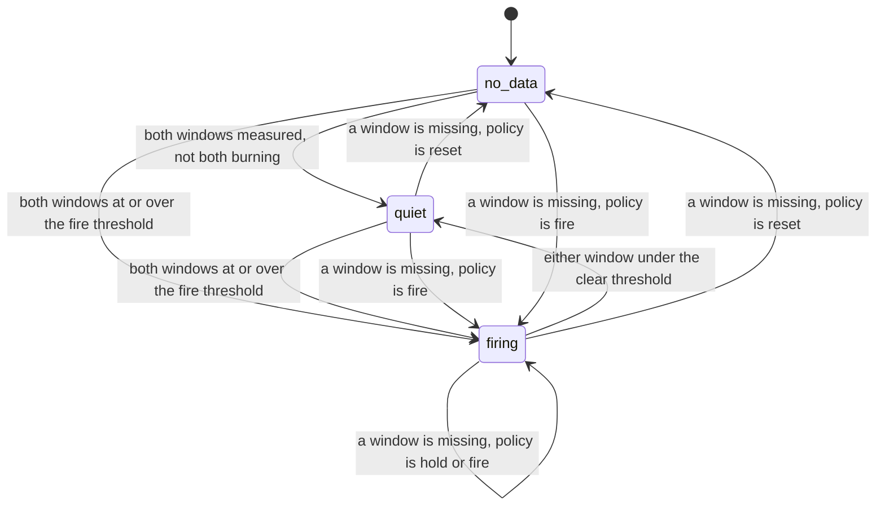
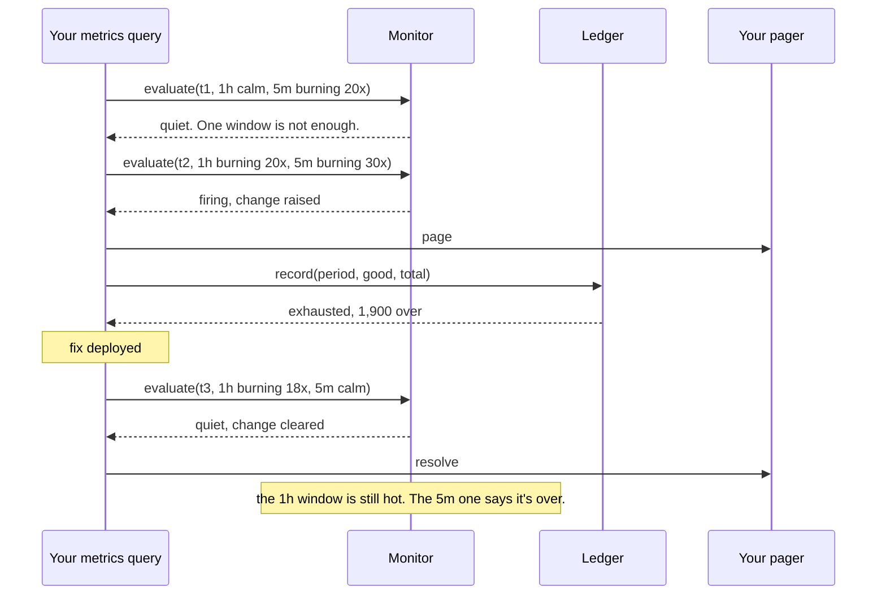

# BudgetMachines

> 99.9% is not a compliment. It is a spending limit. 📉

Error-budget arithmetic for Ruby. You tell it your objective and hand it good and total counts. A ledger tells you how many failures the period can still afford, or how far past the limit you are. A monitor takes a long window and a short window per rule and tells you whether the budget is burning fast enough to wake someone, and when it has stopped. All of it in integers, so the answer is the same on every machine, and "we have no data" is never quietly rounded to "we are fine".

## Quick Start

```bash
gem 'budget_machines'
```

```ruby
# 99.9% of requests succeed, accounted per 30-day period number 0.
ledger = BudgetMachines::Ledger.new(999, 1000, 0)
ledger.record(0, 99_950, 100_000)          # good, total for the window just closed
ledger.account.remaining                   # => 50 failures left

monitor = BudgetMachines::Monitor.new(999, 1000)
monitor.add_rule(14_400, 14_400, 2)        # page: burning at 14.4x, severity 2
monitor.add_rule(6_000, 6_000, 1)          # ticket: burning at 6x, severity 1

decisions = monitor.evaluate(clock.now, [
  [[98_000, 100_000], [9_700, 10_000]],    # rule 0: [1h window, 5m window]
  [[598_000, 600_000], [49_800, 50_000]]   # rule 1: [6h window, 30m window]
])
decisions.first.change                     # => :raised
monitor.worst                              # => 0, go page someone
```

Two objects. Every number is an Integer. Burn rates and thresholds are in thousandths: `14_400` is 14.4 times the sustainable rate.

## A Message to the Resistance

So you have an SLO. Somebody put "99.9%" on a slide, everybody nodded, and then you had to turn it into an alert. You wrote `error_rate > 0.001 for 5m`. It paged you at 3 a.m. for forty failed requests on a night with no traffic. So you raised the threshold. Then a slow leak ate the entire month's budget over nine days at a rate that never crossed it, and you learned about it from a customer.

So you read the chapter. Burn rates, two windows per alert, a fast one and a slow one. You wrote it as a query. The query divides one float by another and compares the result to `14.4`, and on the day traffic drops to zero it divides zero by zero, gets `NaN`, compares `NaN > 14.4`, gets false, and resolves the page for an outage that is so complete nothing is being counted any more.

The piece you keep rebuilding is small. How many failures does this objective allow in this many events? How fast is this window spending them? Are both windows over the line, and is it still over the line now? And what do you say when a window has nothing in it? That arithmetic is this gem.

## Chapter 1: Stardate 2026.316, the AMS Beyer

> **AMS Beyer**, NCC-4225, *Beyer*-class reliability tender.
> A fleet that never spends its budget is flying too slowly. A fleet that never counts it is already out.

The tender doesn't repair anything. It keeps the books. Every ship in the fleet has an agreed number of bad jumps per thousand, and the tender knows how many each one has left this cycle and how quickly it is going through them. When a ship stops reporting, the tender does not write down zero failures. It writes down "no report", which is a different column.

On a bridge somewhere, a cadet volunteers:

```ruby
def alert?(errors, requests)
  errors / requests.to_f > 0.001
end
```

"Run it with no requests," says the tender's purser. "Then tell me whether the ship is healthy or missing."

## The Flight Plan

Each rule in a monitor is in one of three states:



And the afternoon the payment API started failing one request in fifty:



## How the Budget Works

### The objective

An objective is two Integers: `good` of every `per` events.

```ruby
BudgetMachines.allowance(999, 1000, 100_000)         # => 100 failures allowed in 100,000
BudgetMachines.burn_milli(999, 1000, 9_856, 10_000)  # => 14400, i.e. 14.4x
BudgetMachines.burn_milli(999, 1000, 0, 0)           # => nil, no events is not a rate
```

A burn rate of `1000` spends the budget exactly as fast as the objective allows. `999, 1000` and `9_990, 10_000` are the same objective. `1000, 1000` raises `RangeError`: a 100% target has no budget to account.

### Record

```ruby
ledger = BudgetMachines::Ledger.new(99, 100, 7)   # 99%, period 7

ledger.record(7, 995, 1000)   # => :ok
ledger.record(6, 10, 10)      # => :stale_period, nothing added
```

`record` adds a window's good and total to the current period. The period is a number you choose and advance. Counts for any other period are refused. A sum that would not fit in 64 bits is refused with `:overflow`.

When your source gives you the running total instead of a delta, use `replace`:

```ruby
ledger.replace(7, 995, 1000)  # => :ok, the period now holds exactly this
```

### Account

```ruby
account = ledger.account
account.allowance        # => 10   failures 1,000 events may contain at 99%
account.remaining        # => 5
account.standing         # => :within
account.consumed_milli   # => 500  half the budget

BudgetMachines::Ledger.new(99, 100, 7).account.standing   # => :no_data
```

`standing` is `:within`, `:exhausted` or `:no_data`. An `:exhausted` account has `overspent` instead of `remaining`. An empty period is `:no_data`, with a `nil` `consumed_milli`.

The allowance grows with traffic, so one failure in the first ten requests of a period is `:exhausted`. If you'd rather budget against the traffic you expect:

```ruby
ledger = BudgetMachines::Ledger.new(999, 1000, 0)
ledger.record(0, 9, 10)
ledger.account.standing                    # => :exhausted
ledger.account_against(100_000).remaining  # => 99
ledger.account_against(5)                  # => :below_observed
```

### Roll

```ruby
closed = ledger.roll(1)   # => the Account period 0 ended with
ledger.account.standing   # => :no_data
ledger.roll(1)            # => :stale_period
```

`roll` closes the period, hands you its final account, and starts the next one empty. The new period must be greater than the current one. Nothing rolls on its own.

### Rules

```ruby
monitor = BudgetMachines::Monitor.new(999, 1000)
monitor.add_rule(14_400, 14_400, 2)   # => 0
monitor.add_rule(6_000, 3_000, 1)     # => 1
```

A rule is a fire threshold, a clear threshold and a severity. It fires when the long window and the short window both burn at the fire threshold or more. Once firing, it stays firing until either window drops below the clear threshold. Give both the same value for the textbook rule, or a lower clear threshold if you'd like an alert that doesn't flap around the line. A monitor holds `BudgetMachines::CAPACITY` rules, which is 8. The ninth `add_rule` answers `:full`.

### Evaluate

```ruby
hot  = [9_800, 10_000]    # [good, total], burning at 20x
calm = [10_000, 10_000]

monitor.evaluate(1, [[hot, calm], [hot, calm]]).map(&:state)   # => [:quiet, :quiet]

page, ticket = monitor.evaluate(2, [[hot, hot], [hot, hot]])
page.state         # => :firing
page.change        # => :raised
page.long_milli    # => 20000
page.since         # => 2
monitor.worst      # => 0, the firing rule with the highest severity

monitor.evaluate(3, [[hot, calm], [hot, [9_950, 10_000]]]).map(&:change)
# => [:cleared, nil]   rule 1 is at 5x: under its fire line, over its clear line
```

You pass the instant and one `[long, short]` pair per rule, in rule order. You get one `Decision` per rule. `change` is `:raised` or `:cleared` on the evaluation where the alert starts or stops, and `nil` otherwise, so you can page on edges without keeping your own copy of the state.

### No data

A window can be `nil`. It also counts as missing when its total is zero, or below the `min_total` you configured.

```ruby
monitor = BudgetMachines::Monitor.new(999, 1000, on_no_data: :hold, min_total: 100)
monitor.add_rule(14_400, 14_400, 2)

decision = monitor.evaluate(1, [[[9_800, 10_000], nil]]).first
decision.measured     # => false
decision.state        # => :no_data, it has never been measured
decision.short_milli  # => nil
```

`on_no_data` decides what a rule does when it can't be measured:

- `:hold` (the default) keeps the state it had. A firing alert keeps firing through a scrape gap.
- `:reset` puts it back to `:no_data`. A firing alert clears, and says so with `:cleared`.
- `:fire` treats silence as an outage.

Whichever you pick, `measured` is `false` on that decision, so a state the policy chose is never mistaken for one the numbers chose.

### Time only moves forward

```ruby
monitor.evaluate(10, [[hot, hot]])
monitor.evaluate(9, [[hot, hot]])    # => :time_regression
monitor.evaluate(11, [])             # => :shape, one pair per rule
```

A refused evaluation changes no alert state. Evaluating the same instant twice is allowed.

## The Rules of the Tender

- **Everything is an Integer.** Counts, periods and instants are in `0..2**64-1`. Objectives and thresholds are in `0..2**32-1`. Severity is `0..255`. Floats, nil and strings raise `TypeError`. Out of range, `good > total`, a 100% objective, or a clear threshold above the fire threshold raises `RangeError`.
- **Refusals don't raise.** `:stale_period`, `:overflow`, `:below_observed`, `:full`, `:shape` and `:time_regression` are answers, and the object is exactly as it was before you asked.
- **No floats inside.** Thresholds are compared by cross-multiplying in 128 bits. Reported burn rates are rounded down to the thousandth. Decisions never use the rounded number.
- **No data is not zero.** An empty window has a `nil` burn rate. An empty period has no standing.
- **Frozen means frozen.** `freeze` a ledger or a monitor and anything that would change it raises `FrozenError`. Reading still works.

## What You Think You're Doing vs Reality

### You Think: "Zero errors in the window, so the alert can clear."
### Reality: Zero requests in the window, because the load balancer is on fire.

Zero failures out of ten thousand and zero failures out of zero look identical once you've divided. They aren't the same fact. The first is a measurement. The second is the absence of one, and it shows up most reliably during the outages you most wanted to hear about. The monitor keeps them apart and makes you say, once, in the constructor, what silence means for you.

## What's Yours

This is the initial release of a policy core, and the API will change. It does arithmetic and remembers which alerts are firing. It does not collect metrics, run queries, know what time it is, send pages, or decide what a good request is. You bring the counts for each window, exact, from wherever you keep them, and you choose the window lengths. `window_machines` can give you the window boundaries. You decide when a compliance period ends and call `roll`. State lives in your process and is gone when it exits, so persist what you can't afford to recompute. If an empty budget should shed load or open a breaker, that is your coordinator reading an `Account` and telling `shed_machines` or `breaker_machines` what to do. This gem will not do it behind your back.

## License

MIT License. See [LICENSE.txt](LICENSE.txt) for details.

**Remember: the budget is there to be spent. Just not by accident, and not all on a Tuesday.**
